<div align="center">

# 😴 Étude de la Santé du Sommeil

### Prédire les troubles du sommeil grâce à l'analyse du mode de vie


<br>


<em>Arbre de décision final (profondeur maximale = 5) : 93,3 % d'accuracy sur la base de test</em>

</div>

---

## 📑 Sommaire

1. [Résumé](#-résumé)
2. [Contexte et objectifs](#-contexte-et-objectifs)
3. [Les données](#-les-données)
4. [Structure du projet](#️-structure-du-projet)
5. [Méthodologie détaillée](#-méthodologie-détaillée)
6. [Pourquoi une profondeur de 5 ?](#-pourquoi-une-profondeur-optimale-de-5-)
7. [Résultats du modèle](#-résultats-du-modèle)
8. [Limites et précautions](#️-limites-et-précautions)
9. [Installation et utilisation](#️-installation-et-utilisation)
10. [Reproductibilité](#-reproductibilité)
11. [Dépannage](#️-dépannage)
12. [Pistes d'amélioration](#-pistes-damélioration)
13. [Index des graphiques](#️-index-des-graphiques)
14. [Glossaire](#-glossaire)
15. [Références](#-références)
16. [Auteur](#-auteur)

---

## 🧾 Résumé

| | |
|---|---|
| **Problème** | Prédire si une personne souffre d'un trouble du sommeil (insomnie ou apnée) à partir de son profil physiologique et de ses habitudes de vie |
| **Données** | *Sleep Health and Lifestyle Dataset* (Kaggle) : 374 personnes, 11 variables explicatives |
| **Cible** | Binaire : `0` = aucun trouble, `1` = insomnie **ou** apnée du sommeil |
| **Modèle** | Arbre de décision (`DecisionTreeClassifier`), profondeur maximale **5** choisie par validation croisée à 10 plis |
| **Performance (test)** | Accuracy **93,33 %** · AUC **0,90** · précision 0,97 / rappel 0,88 sur la classe « trouble » |
| **Variable la plus déterminante** | La **catégorie d'IMC** (≈ 82 % de l'importance) |
| **⚠️ Point de vigilance** | 70 des 75 personnes de test ont un profil strictement identique à une personne d'entraînement : les performances sont très probablement **surestimées** (voir [Limites](#️-limites-et-précautions)) |

---

## 🎯 Contexte et objectifs

Les troubles du sommeil sont un enjeu de santé publique concret, qui touche potentiellement tout le monde. Le jeu de données choisi associe des **variables physiologiques** (fréquence cardiaque, pression artérielle, IMC) et des **habitudes de vie** (activité physique, stress, durée de sommeil), ce qui en fait un bon terrain d'étude.

Le projet répond à quatre questions :

1. **Qui est concerné ?** Quel est le profil de la population étudiée ?
2. **Qu'est-ce qui diffère** entre les personnes avec et sans trouble du sommeil ?
3. **Ces différences sont-elles statistiquement significatives ?**
4. **Peut-on prédire** la présence d'un trouble à partir du profil, et avec quelle fiabilité ?

Le script `Arbre_décisionnel_Sleep_healt.py` répond à ces questions de bout en bout : exploration, visualisation, tests statistiques, modélisation, optimisation et évaluation.

---

## 📋 Les données

### Source et volumétrie

- **Source** : *Sleep Health and Lifestyle Dataset*, publié sur [Kaggle](https://www.kaggle.com/)
- **Fichier** : `Sleep_healt.csv` · **374 lignes × 13 colonnes** · **aucune valeur manquante**

### Dictionnaire des variables

| Colonne | Type | Description | Rôle dans l'analyse |
|---------|------|-------------|---------------------|
| `Person ID` | Entier | Identifiant de la personne | Exclu (identifiant sans valeur prédictive) |
| `Gender` | Catégorielle | `Male` / `Female` | Variable explicative (encodée 0/1) |
| `Age` | Numérique | Âge en années (27 à 59, moyenne 42,2) | Variable explicative |
| `Occupation` | Catégorielle | Profession (11 modalités, ex. Nurse, Doctor, Engineer) | Variable explicative (encodée) |
| `Sleep Duration` | Numérique | Durée de sommeil en heures (5,8 à 8,5, moyenne 7,13) | Variable explicative |
| `Quality of Sleep` | Ordinale | Qualité du sommeil, échelle de 4 à 9 | Variable explicative |
| `Physical Activity Level` | Numérique | Activité physique en minutes par jour (30 à 90, moyenne 59) | Variable explicative |
| `Stress Level` | Ordinale | Niveau de stress, échelle de 3 à 8 | Variable explicative |
| `BMI Category` | Catégorielle | `Normal`, `Normal Weight`, `Overweight`, `Obese` | Variable explicative (encodée 0/1/2) |
| `Blood Pressure` | Texte | Pression artérielle au format `systolique/diastolique` | Transformée en `BP_Category` |
| `Heart Rate` | Numérique | Fréquence cardiaque au repos en bpm (65 à 86, moyenne 70,2) | Variable explicative |
| `Daily Steps` | Numérique | Nombre de pas par jour (3 000 à 10 000, moyenne 6 817) | Variable explicative |
| `Sleep Disorder` | Catégorielle | `None`, `Insomnia`, `Sleep Apnea` | **Cible** (regroupée en binaire) |

### Répartition de la cible

| Classe d'origine | Effectif | Classe du modèle (`Outcome`) |
|------------------|:--------:|:----------------------------:|
| `No Sleep Disorder` | 219 (58,6 %) | **0** |
| `Insomnia` | 77 (20,6 %) | **1** |
| `Sleep Apnea` | 78 (20,9 %) | **1** |

Au total, **155 personnes (41,4 %)** présentent un trouble. Le jeu de données est donc raisonnablement équilibré, sans nécessiter de rééquilibrage.

### Qualité des données : points à connaître

- ✅ **Aucune valeur manquante.**
- ⚠️ **Modalités quasi équivalentes** : `Normal` (195 personnes) et `Normal Weight` (21 personnes) désignent le même niveau d'IMC. Le script les **fusionne** dans la même classe (0).
- ⚠️ **Pression artérielle** : seules **3 catégories sur 7** possibles sont réellement présentes (hypertension légère : 232, hypertension modérée : 100, normale : 42). Aucun cas d'hypotension n'apparaît dans l'échantillon.
- ⚠️ **Nombreux profils répétés** : sur 374 lignes, **265 sont des doublons** des variables explicatives, soit seulement **109 profils distincts**. C'est le point le plus important pour interpréter les résultats (voir [Limites](#️-limites-et-précautions)).

### Aperçu de la population

Population de 27 à 59 ans, répartie presque à égalité entre hommes (189) et femmes (185). Plus d'une personne sur trois est concernée par un trouble du sommeil (155 sur 374).

<table>
  <tr>
    <td align="center">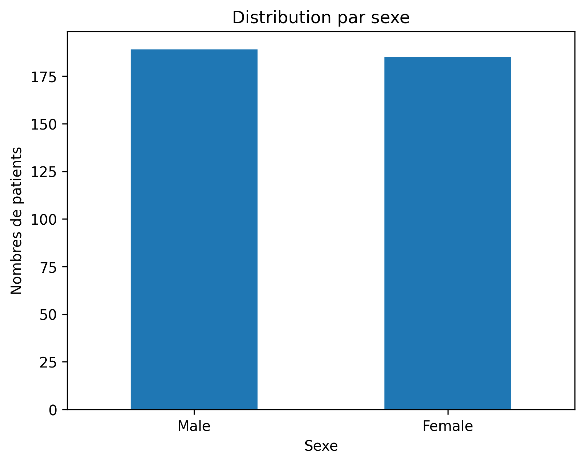<br><sub><b>Répartition par sexe</b></sub></td>
    <td align="center"><br><sub><b>Âge par tranches de 5 ans</b></sub></td>
  </tr>
  <tr>
    <td align="center">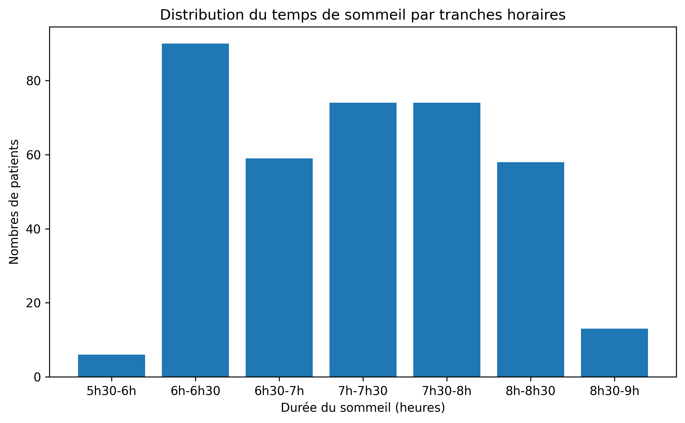<br><sub><b>Durée de sommeil par tranches de 30 min</b></sub></td>
    <td align="center"><br><sub><b>Catégories d'IMC</b></sub></td>
  </tr>
  <tr>
    <td align="center"><br><sub><b>Qualité du sommeil (échelle 4 à 9)</b></sub></td>
    <td align="center">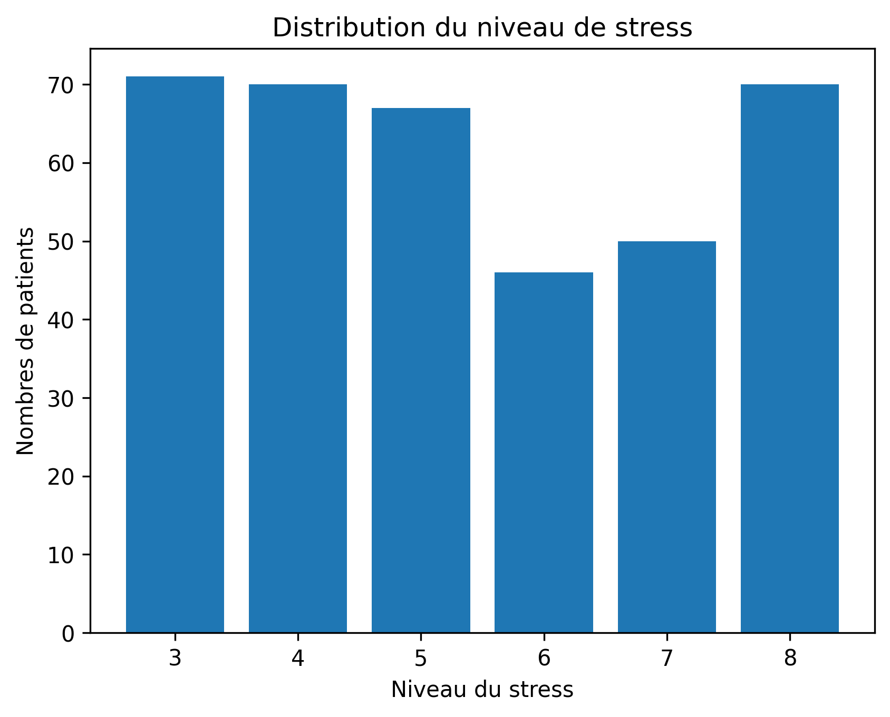<br><sub><b>Niveau de stress</b></sub></td>
  </tr>
</table>

<details>
<summary><b>📂 Voir les autres distributions</b> (âge, profession, durée de sommeil, activité physique, troubles du sommeil, pression artérielle, rythme cardiaque)</summary>

<br>

<table>
  <tr>
    <td align="center"><br><sub><b>Âge (histogramme)</b></sub></td>
    <td align="center">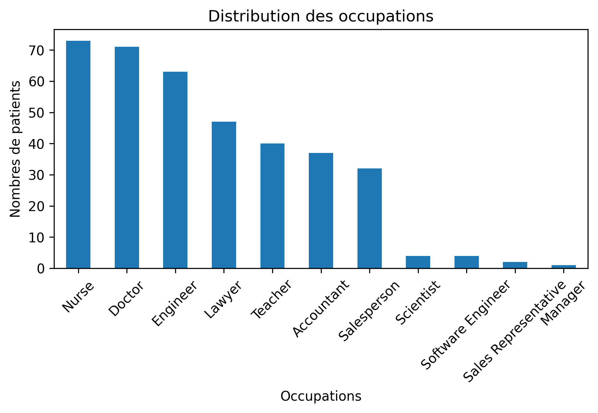<br><sub><b>Professions (11 modalités)</b></sub></td>
  </tr>
  <tr>
    <td align="center">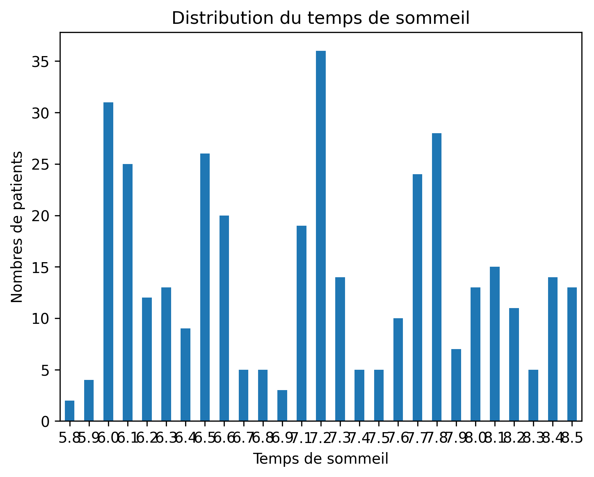<br><sub><b>Durée de sommeil (par valeur exacte)</b></sub></td>
    <td align="center">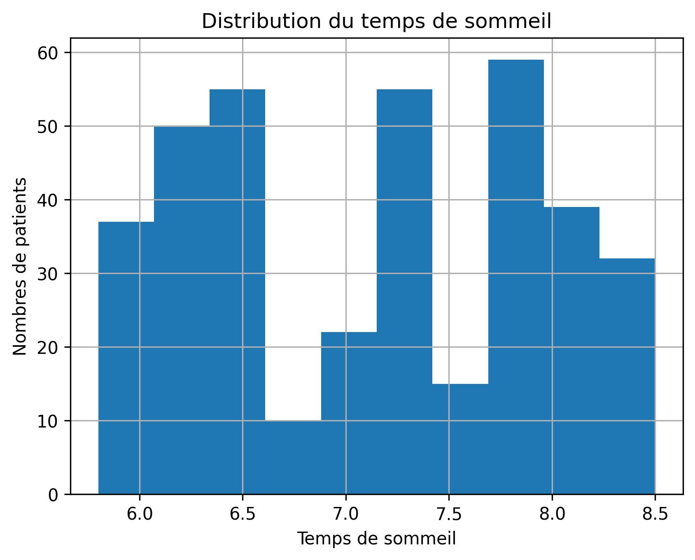<br><sub><b>Durée de sommeil (histogramme)</b></sub></td>
  </tr>
  <tr>
    <td align="center"><br><sub><b>Activité physique (minutes par jour)</b></sub></td>
    <td align="center">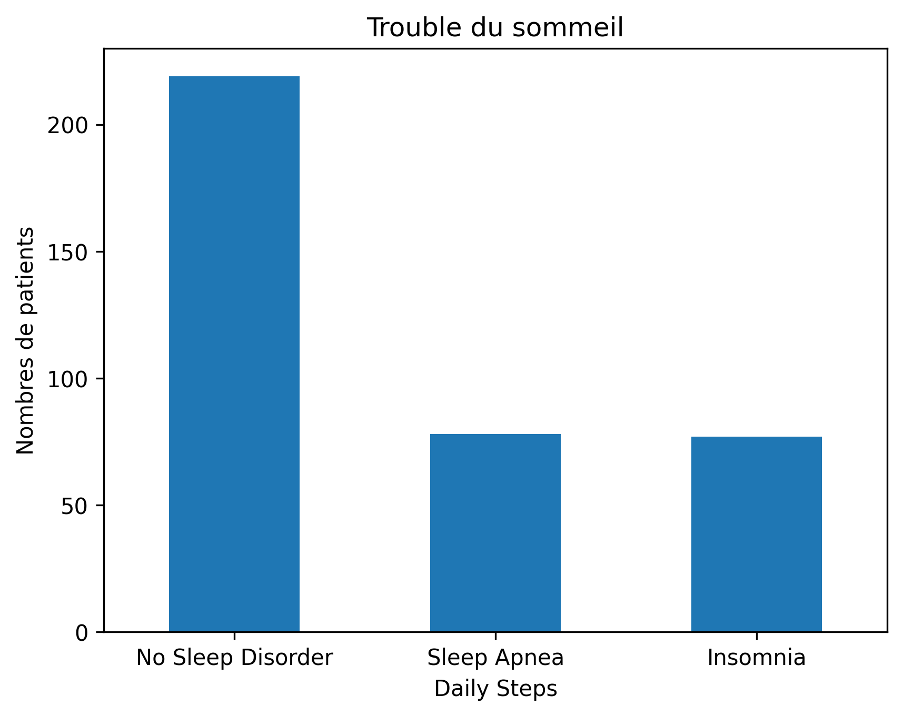<br><sub><b>Troubles du sommeil (cible)</b> · ⚠️ l'axe horizontal porte le libellé « Daily Steps » (erreur de libellé dans le script)</sub></td>
  </tr>
  <tr>
    <td align="center"><br><sub><b>Catégories de pression artérielle (3 catégories sur 7 présentes)</b></sub></td>
    <td align="center">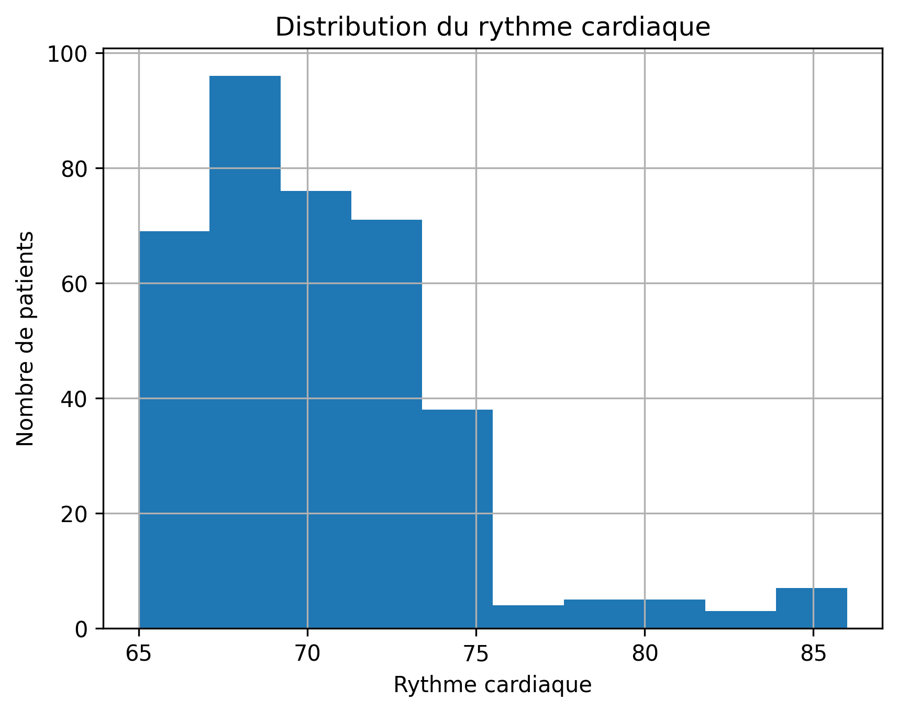<br><sub><b>Rythme cardiaque (bpm)</b></sub></td>
  </tr>
</table>

</details>

---

## 🗂️ Structure du projet

```text
Sleep-Healt-and-Lifestyle-Dataset/
├── 📄 Arbre_décisionnel_Sleep_healt.py   # Script complet : analyse + machine learning
├── 📄 Sleep_healt.csv                    # Dataset (374 personnes, 13 colonnes)
├── 📄 README.md                          # Ce fichier
└── 📁 Graphiques/                        # 30 graphiques PNG (300 dpi) générés par le script et affichés dans ce README
```

Le script est organisé en blocs successifs, qui suivent l'ordre de la méthodologie ci-dessous.

---

## 🔬 Méthodologie détaillée


### 1. Chargement et exploration

Le CSV est chargé dans un DataFrame pandas. Quatre contrôles sont affichés : structure et types (`info()`), statistiques descriptives (`describe()`), nombre de valeurs uniques par colonne (`nunique()`) et valeurs manquantes (`isnull().sum()`).

### 2. Préparation et ingénierie des variables

**a) Catégorisation de la pression artérielle.** La valeur brute (`"126/83"`) est séparée en pression systolique et diastolique, puis classée selon le barème du site [ICM 46 Healthy](https://icm46.fr/comment-interpreter-resultats-pression-arterielle/). Les tests sont appliqués **dans cet ordre** (la première condition vérifiée l'emporte) :

| Catégorie | Condition (systolique / diastolique en mmHg) |
|-----------|-----------------------------------------------|
| Hypertension sévère | systolique > 160 **ou** diastolique > 100 |
| Hypertension modérée | systolique 140-159 **ou** diastolique 90-99 |
| Hypertension légère | systolique 130-139 **ou** diastolique 80-89 |
| Hypotension sévère | systolique < 80 **ou** diastolique < 50 |
| Hypotension modérée | systolique 80-89 **ou** diastolique 50-59 |
| Hypotension légère | systolique < 90 **ou** diastolique < 60 |
| Normale | dans tous les autres cas |
| Non spécifié | valeur illisible (gestion d'erreur `try/except`) |

**b) Encodage de la cible.** `Sleep Disorder` devient `Outcome` : `No Sleep Disorder` → **0**, `Insomnia` et `Sleep Apnea` → **1**. Le problème est donc une **classification binaire** : le modèle détecte la présence d'un trouble, pas son type.

**c) Encodage des variables explicatives.** Un arbre de décision de scikit-learn n'accepte que des nombres :

| Variable | Encodage | Commentaire |
|----------|----------|-------------|
| `Gender` | `Male` = 0, `Female` = 1 | Binaire |
| `BMI Category` | `Normal` et `Normal Weight` = 0, `Overweight` = 1, `Obese` = 2 | Ordinal, dans l'ordre croissant |
| `Occupation` | Code entier par ordre alphabétique (`cat.codes`) | Ordre **arbitraire** (sans signification) |
| `BP_Category` | Code entier par ordre alphabétique (`cat.codes`) | Ordre **arbitraire** (sans signification) |

> 💡 Un arbre peut isoler n'importe quelle valeur par une succession de seuils : l'ordre arbitraire de `Occupation` ou `BP_Category` est donc peu gênant pour la modélisation. Il rend en revanche **non interprétables** les coefficients de corrélation associés dans la heatmap.

**d) Regroupements en tranches (`pd.cut`).** L'âge (tranches de 5 ans) et la durée de sommeil (tranches de 30 minutes) sont regroupés pour des histogrammes plus lisibles. Ces colonnes (`Tranche_Age`, `Tranche_Sommeil`) servent **uniquement à la visualisation** et sont exclues du modèle.

### 3. Visualisations et sauvegarde automatique

Trois techniques selon le type de variable :

| Type de variable | Exemples | Méthode |
|------------------|----------|---------|
| Numérique continue | Âge, rythme cardiaque | `.hist()` |
| Numérique regroupée en tranches | Âge, durée de sommeil | `pd.cut(bins=...)` puis diagramme en barres |
| Catégorielle | Sexe, profession, IMC | `.value_counts().plot(kind="bar")` |

La fonction `save_plot_with_title()` sauvegarde chaque graphique **sans jamais écraser un fichier précédent** :

1. elle incrémente un compteur global (`plot_counter`) ;
2. elle lit le titre du graphique courant (`plt.gca().get_title()`) ;
3. elle construit un nom de fichier `compteur.titre` en remplaçant les espaces par des `_` et en supprimant les guillemets ;
4. elle crée le dossier `Graphiques/` si besoin et enregistre en PNG à **300 dpi** (`bbox_inches="tight"`).

### 4. Analyse bivariée : boxplots « sans trouble vs avec trouble »

Pour chaque variable numérique, un boxplot compare les deux groupes (`Outcome` = 0 ou 1). La **médiane** de chaque groupe est annotée sur le graphique.

> 📖 **Lire un boxplot** : la ligne centrale est la médiane, la boîte contient 50 % des valeurs (du 1ᵉʳ au 3ᵉ quartile), les moustaches s'étendent jusqu'aux valeurs non aberrantes et les points isolés sont des valeurs atypiques.

<table>
  <tr>
    <td align="center"><br><sub><b>Âge · médiane 38 → 45 ans</b></sub></td>
    <td align="center"><br><sub><b>Durée de sommeil · médiane 7,4 → 6,5 h</b></sub></td>
  </tr>
  <tr>
    <td align="center"><br><sub><b>Qualité du sommeil · médiane 8 → 7</b></sub></td>
    <td align="center"><br><sub><b>Niveau de stress · médiane 5 → 7</b></sub></td>
  </tr>
  <tr>
    <td align="center"><br><sub><b>Rythme cardiaque · médiane 70 → 72 bpm</b></sub></td>
    <td align="center"><br><sub><b>Activité physique · médiane 60 → 45 (non significatif)</b></sub></td>
  </tr>
  <tr>
    <td align="center"><br><sub><b>Pas quotidiens · médiane 7 000 → 6 000 (non significatif)</b></sub></td>
    <td align="center"><br><sub><b>Catégorie d'IMC · 0 = normal, 1 = surpoids, 2 = obèse</b></sub></td>
  </tr>
</table>

**Lecture** : les personnes avec un trouble du sommeil sont en moyenne **plus âgées**, **plus stressées**, **dorment moins** et **moins bien**, et ont un rythme cardiaque **plus élevé et plus dispersé**.

> 🔎 **Deux cas à ne pas sur-interpréter.** Pour l'**activité physique** et les **pas quotidiens**, les médianes semblent différer entre les groupes, mais les distributions se chevauchent largement : le test de Kruskal-Wallis ci-dessous confirme que ces écarts ne sont **pas significatifs** (p = 0,17 et p = 0,15). Quant à l'**IMC**, il ne prend que 3 valeurs (0, 1, 2) : le boxplot est « écrasé » et peu lisible, d'où le tableau de taux plus bas, dans la section [Importance des variables](#-importance-des-variables).

### 5. Tests statistiques : Kruskal-Wallis

Les boxplots suggèrent des différences, mais ne prouvent rien : elles pourraient être dues au hasard. Le **test de Kruskal-Wallis** (`scipy.stats.kruskal`) vérifie, pour chaque variable numérique, si la distribution diffère entre les deux groupes.

- **H₀** : il n'y a pas de différence entre les personnes avec et sans trouble.
- **H₁** : il existe une différence significative.
- **Règle de décision** : si p-value < 0,05, on rejette H₀.

**Pourquoi ce test ?** C'est un test **non paramétrique** : il ne suppose pas que les données suivent une loi normale, ce qui convient ici (variables ordinales comme le stress et la qualité du sommeil, distributions non gaussiennes).

| Variable | p-value | Significative (α = 0,05) |
|----------|---------|:------------------------:|
| Age | 2,99 × 10⁻¹⁸ | ✅ |
| Sleep Duration | 3,63 × 10⁻⁹ | ✅ |
| Quality of Sleep | 5,73 × 10⁻⁹ | ✅ |
| Heart Rate | 7,89 × 10⁻⁸ | ✅ |
| Stress Level | 2,46 × 10⁻³ | ✅ |
| Physical Activity Level | 1,69 × 10⁻¹ | ❌ |
| Daily Steps | 1,54 × 10⁻¹ | ❌ |

> ⚠️ **Deux précautions d'interprétation.** (1) Sept tests sont réalisés : avec une correction de Bonferroni (α = 0,05 / 7 ≈ 0,007), les cinq variables restent significatives. (2) Une différence **significative** ne signifie ni **causale** ni **importante en pratique**.

### 6. Matrice de corrélation

La heatmap affiche la **corrélation de Pearson** (de −1 à +1) entre toutes les variables, les variables catégorielles étant préalablement encodées. Pour cette figure, `Sleep Disorder` est codée 0 (aucun), 1 (insomnie), 2 (apnée).

<div align="center">
  
  <p><em>Corrélation de Pearson entre toutes les variables (catégorielles encodées)</em></p>
</div>

Principaux enseignements :

- 🔗 La **catégorie d'IMC** est la variable la plus corrélée au trouble du sommeil (**r = 0,73**).
- 😰 Le **stress** est très fortement corrélé à la qualité du sommeil (r = −0,90) et à sa durée (r = −0,81).
- 😴 La **durée** et la **qualité** du sommeil sont elles-mêmes très corrélées (r = 0,88).
- 🚶 Les **pas quotidiens** sont liés à l'activité physique (r = 0,77).

> ⚠️ La corrélation de Pearson mesure une relation **linéaire**. Pour `Gender`, `Occupation` et `BP_Category`, elle dépend de l'encodage choisi et doit être lue avec prudence.

### 7. Préparation de la modélisation

**Variables explicatives retenues (11)** : `Gender`, `Age`, `Occupation`, `Sleep Duration`, `Quality of Sleep`, `Physical Activity Level`, `Stress Level`, `Heart Rate`, `Daily Steps`, `BP_Category`, `BMI Category`.

**Variables écartées :**

| Variable | Raison |
|----------|--------|
| `Person ID` | Simple identifiant |
| `Blood Pressure` | Remplacée par `BP_Category` (texte non exploitable) |
| `Sleep Disorder`, `Outcome` | Ce sont la **cible** : les garder fausserait totalement le modèle |
| `Tranche_Age`, `Tranche_Sommeil` | Redondantes avec `Age` et `Sleep Duration` |
| `BMI Category` (texte) | Remplacée par sa version numérique |

**Séparation apprentissage / test.** `train_test_split(test_size=0.2, random_state=42)` :

| Ensemble | Effectif | Rôle |
|----------|:--------:|------|
| Apprentissage (train) | 299 (80 %) | Construire l'arbre **et** choisir la profondeur |
| Test | 75 (20 %) | Évaluer le modèle final sur des données non utilisées pour l'entraînement |

Le découpage 80/20 est adapté à la **petite taille** du jeu de données. `random_state=42` rend le découpage **reproductible**.

### 8. L'arbre de décision, en bref

Un arbre de décision pose une série de questions simples sur les variables (ex. « IMC ≤ 0,5 ? », « Âge ≤ 41,5 ? »). Chaque réponse oriente vers une branche, jusqu'à une **feuille** qui donne la prédiction. À chaque nœud, l'algorithme choisit la question qui **sépare le mieux** les deux classes, au sens de l'indice de **Gini** (0 = nœud parfaitement pur, 0,5 = mélange équilibré). Les arbres sont **interprétables**, rapides à entraîner et demandent peu de préparation des données.

**Premier modèle : arbre non élagué (référence).** Sans limite de profondeur, l'arbre grandit jusqu'à ce que chaque feuille soit pure :

| Caractéristique | Valeur |
|-----------------|:------:|
| Profondeur atteinte | 13 |
| Nombre de feuilles | 46 |
| Accuracy train / test | 93,98 % / 93,33 % |
| AUC train / test | 0,99 / 0,92 |

> 🔎 **Pourquoi l'accuracy d'entraînement n'atteint-elle pas 100 % ?** Un arbre sans limite mémorise normalement tout l'apprentissage. Ici, ce n'est pas le cas : certains profils **strictement identiques** portent des étiquettes **contradictoires** (avec et sans trouble), qu'aucune question ne peut séparer. C'est un symptôme direct de la présence de profils répétés dans les données.

---

## 🎯 Pourquoi une profondeur optimale de 5 ?

### Le problème : le compromis biais / variance

La **profondeur maximale** (`max_depth`) fixe le nombre de questions successives que l'arbre peut poser :

- **Trop faible** → l'arbre est trop simple pour capter les motifs des données : c'est le **sous-apprentissage** (*underfitting*).
- **Trop élevée** → l'arbre épouse les particularités de l'échantillon d'entraînement, y compris le bruit : c'est le **surapprentissage** (*overfitting*). Il généralise moins bien et devient illisible.

Il faut donc trouver la profondeur qui offre **le meilleur compromis entre performance et simplicité**.

### La méthode : validation croisée à 10 plis

Le script teste **toutes les profondeurs de 1 à 14** et évalue chacune par **validation croisée à 10 plis** (`cross_val_score(..., cv=10)`) :

1. la base d'entraînement (299 personnes) est découpée en 10 blocs ;
2. pour chaque profondeur, l'arbre est entraîné 10 fois, chaque fois sur 9 blocs, puis testé sur le bloc restant ;
3. les 10 scores sont moyennés : c'est le **score de validation croisée** de cette profondeur ;
4. la profondeur retenue est celle qui maximise ce score (`np.argmax`).

> 🔒 **Bonne pratique respectée** : la validation croisée utilise **uniquement la base d'entraînement**. La base de test reste intacte pour l'évaluation finale. Choisir la profondeur sur la base de test reviendrait à « tricher » (fuite d'information).

<div align="center">
  
  <p><em>Score moyen de validation croisée (10 plis) selon la profondeur maximale de l'arbre : le maximum est atteint dès la profondeur 5 (≈ 0,933), suivi d'un plateau jusqu'à 8 puis d'un léger recul.</em></p>
</div>

### Les résultats, profondeur par profondeur

| Profondeur | Score de validation croisée | Écart-type entre plis | Accuracy train | Nombre de feuilles |
|:---:|:---:|:---:|:---:|:---:|
| 1 | 0,9030 | 0,062 | 0,9030 | 2 |
| 2 | 0,8963 | 0,057 | 0,9130 | 4 |
| 3 | 0,9130 | 0,058 | 0,9331 | 7 |
| 4 | 0,9297 | 0,068 | 0,9398 | 11 |
| **5** | **0,9331** | 0,067 | 0,9398 | **17** |
| 6 | 0,9298 | 0,064 | 0,9398 | 24 |
| 7 | 0,9331 | 0,067 | 0,9398 | 30 |
| 8 | 0,9331 | 0,067 | 0,9398 | 35 |
| 9 | 0,9264 | 0,061 | 0,9398 | 38 |
| 10 | 0,9263 | 0,065 | 0,9398 | 41 |
| 11 | 0,9197 | 0,060 | 0,9398 | 43 |
| 12 | 0,9197 | 0,060 | 0,9398 | 45 |
| 13 | 0,9264 | 0,061 | 0,9398 | 46 |
| 14 | 0,9264 | 0,061 | 0,9398 | 46 |

### Comment lire cette courbe

1. **Profondeurs 1 à 3 : sous-apprentissage.** L'arbre est trop simple : le score de validation croisée est bas (0,90, 0,90 puis 0,91) et l'accuracy d'entraînement l'est aussi.
2. **Profondeurs 4 à 5 : le gain est net.** Le score grimpe à 0,930 puis **0,9331**, son maximum.
3. **Profondeurs 5 à 8 : plateau.** Le score reste au maximum. Les profondeurs **5, 7 et 8 sont à égalité parfaite** (0,9331).
4. **Au-delà de 8 : léger recul.** Le score redescend vers 0,92-0,93 alors que l'accuracy d'entraînement **ne progresse plus** (0,9398 dès la profondeur 4) : les niveaux supplémentaires n'apportent rien d'utile, seulement de la complexité.

### Pourquoi 5 plutôt que 7 ou 8 ?

Trois profondeurs atteignent le même score maximal. La fonction `np.argmax` renvoie **la première** d'entre elles, donc la plus petite : **5**. Ce choix est aussi le bon sur le fond, car c'est l'application du **principe de parcimonie** (rasoir d'Occam) : à performance égale, on préfère le modèle le plus simple.

| Profondeur | Score CV | Feuilles | Lisibilité |
|:---:|:---:|:---:|---|
| **5** | 0,9331 | **17** | Arbre lisible et interprétable |
| 7 | 0,9331 | 30 | Presque deux fois plus de règles pour le même score |
| 8 | 0,9331 | 35 | Plus de deux fois plus de règles pour le même score |

La profondeur 5 donne donc **le même score avec 17 feuilles au lieu de 30 ou 35**. Un arbre plus petit est plus facile à expliquer, moins sensible aux particularités de l'échantillon, et plus stable.

### ⚖️ Nuance importante : un optimum « raisonnable », pas « unique »

Soyons précis sur ce que la validation croisée permet de conclure :

- Les écarts entre les profondeurs 4 et 10 sont de l'ordre de **0,01** ; l'écart-type entre plis est d'environ **0,065**, soit **6 fois plus**. Ces profondeurs sont **statistiquement indiscernables**.
- La profondeur 5 n'est donc pas « la vraie » valeur optimale : c'est **un choix défendable** dans une zone de performances équivalentes.
- Avec la **règle de l'erreur standard** (choisir le modèle le plus simple dont le score reste dans une erreur standard du meilleur, soit ≥ 0,912), la profondeur **3** (0,913) serait même suffisante.
- Sur la base de test, l'accuracy vaut **93,33 % pour toutes les profondeurs de 2 à 14** : le test ne permet pas non plus de les départager.

> ✅ **En résumé** : la profondeur 5 est retenue parce qu'elle atteint le **score maximal de validation croisée avec le plus petit arbre possible**. Elle évite le sous-apprentissage (profondeurs 1 à 3) et la complexité inutile (profondeurs ≥ 9).

---

## 📈 Résultats du modèle

### Comparaison avant / après élagage

| | Arbre non élagué | **Arbre élagué (profondeur 5)** |
|---|:---:|:---:|
| Profondeur | 13 | **5** |
| Feuilles | 46 | **17** |
| Accuracy train | 93,98 % | 93,98 % |
| Accuracy test | 93,33 % | 93,33 % |
| AUC train | 0,99 | 0,97 |
| AUC test | 0,92 | 0,90 |

<table>
  <tr>
    <td align="center"><br><sub><b>Arbre non élagué · profondeur 13, 46 feuilles</b></sub></td>
    <td align="center"><br><sub><b>Arbre élagué · profondeur 5, 17 feuilles</b></sub></td>
  </tr>
</table>

À retenir, honnêtement : l'élagage **ne fait pas progresser** l'accuracy de test, et l'AUC de test est même légèrement inférieure (0,90 contre 0,92). Son bénéfice est ailleurs : un arbre **près de trois fois plus petit** (17 feuilles contre 46), plus lisible, moins enclin au surapprentissage et plus stable.

### Performances du modèle final (profondeur 5)

| Métrique | Train | Test |
|----------|:-----:|:----:|
| **Accuracy** | 93,98 % | **93,33 %** |
| **AUC ROC** | 0,97 | **0,90** |

<table>
  <tr>
    <td align="center">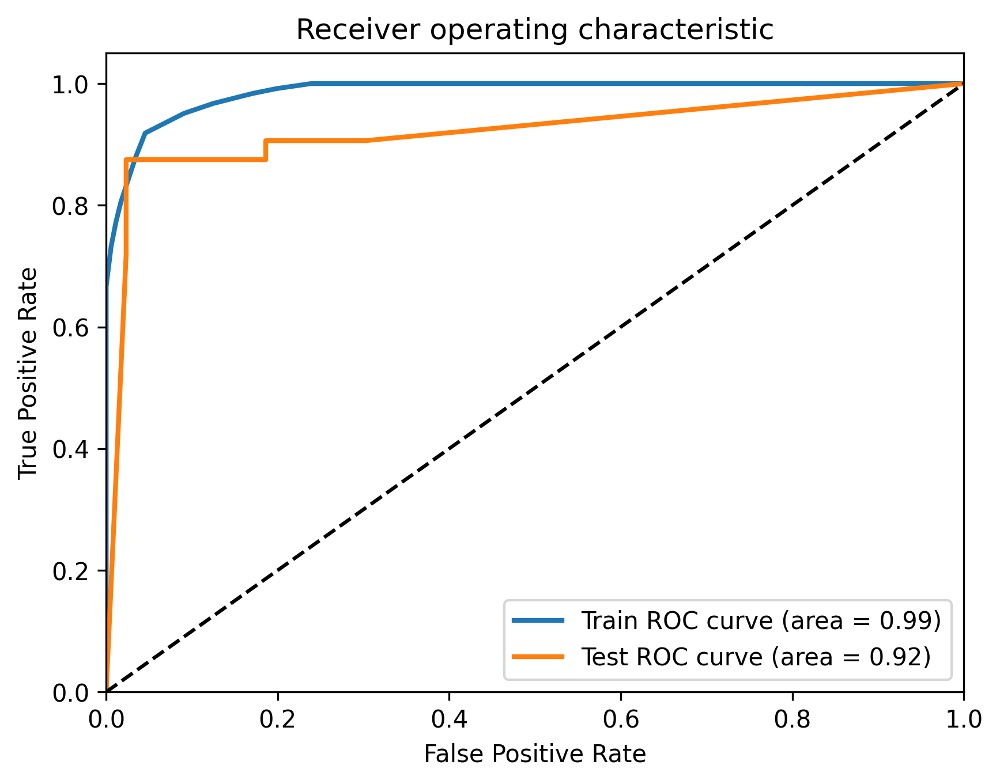<br><sub><b>Courbes ROC · arbre non élagué (AUC train 0,99 · test 0,92)</b></sub></td>
    <td align="center">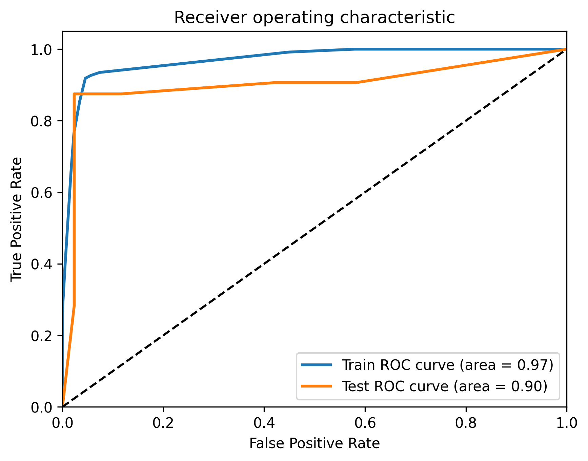<br><sub><b>Courbes ROC · arbre élagué, profondeur 5 (AUC train 0,97 · test 0,90)</b></sub></td>
  </tr>
</table>

**Matrice de confusion (test, 75 personnes)**

|  | Prédit : sans trouble | Prédit : trouble |
|--|:---------------------:|:----------------:|
| **Réel : sans trouble** | 42 (vrais négatifs) | 1 (faux positif) |
| **Réel : trouble** | 4 (faux négatifs) | 28 (vrais positifs) |

**Rapport de classification (test)**

| Classe | Précision | Rappel | F1-score | Support |
|--------|:---------:|:------:|:--------:|:-------:|
| 0 · Sans trouble | 0,91 | 0,98 | 0,94 | 43 |
| 1 · Trouble | 0,97 | 0,88 | 0,92 | 32 |

### 📖 Comment lire ces métriques

| Métrique | Définition | Dans ce projet |
|----------|-----------|----------------|
| **Accuracy** | Part de prédictions correctes | 70 prédictions justes sur 75 |
| **Précision** (classe « trouble ») | Quand le modèle annonce un trouble, a-t-il raison ? | 0,97 : 28 alertes sur 29 sont justes |
| **Rappel** (classe « trouble ») | Parmi les vrais troubles, combien sont détectés ? | 0,88 : 28 détectés sur 32 |
| **F1-score** | Moyenne harmonique de la précision et du rappel | 0,92 |
| **AUC ROC** | Capacité à classer un malade au-dessus d'un non-malade (0,5 = hasard, 1 = parfait) | 0,90 |

**Lecture clinique.** Le modèle commet **4 faux négatifs** (personnes avec trouble jugées saines) contre **1 seul faux positif**. Pour un outil de dépistage, les faux négatifs sont l'erreur la plus coûteuse : le rappel (0,88) est donc la métrique à surveiller en priorité.

### 🏆 Importance des variables

<table>
  <tr>
    <td align="center">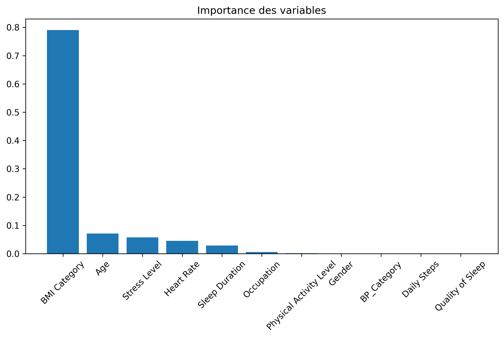<br><sub><b>Importance des variables · arbre non élagué (IMC ≈ 0,79)</b></sub></td>
    <td align="center">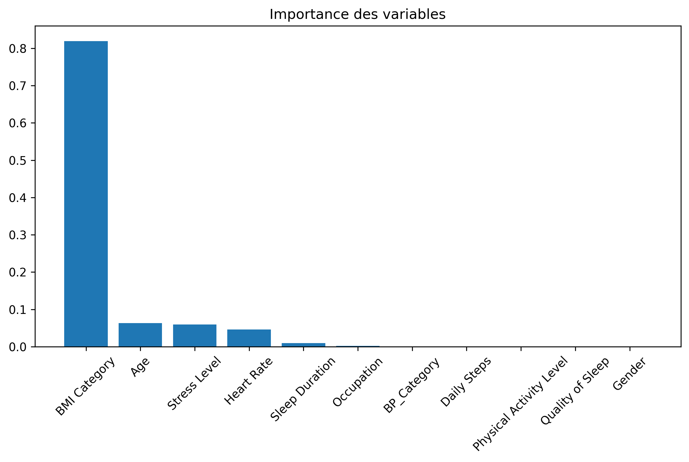<br><sub><b>Importance des variables · arbre élagué (IMC ≈ 0,82)</b></sub></td>
  </tr>
</table>

Importance dans l'**arbre final** (profondeur 5, somme = 1) :

| Rang | Variable | Importance |
|:---:|----------|:----------:|
| 1 | **BMI Category** | **0,819** |
| 2 | Age | 0,063 |
| 3 | Stress Level | 0,060 |
| 4 | Heart Rate | 0,046 |
| 5 | Sleep Duration | 0,010 |
| 6 | Occupation | 0,002 |
| 7 | Gender, Physical Activity Level, Quality of Sleep, Daily Steps, BP_Category | 0,000 |

**Pourquoi l'IMC domine-t-il ?** Les données le montrent clairement :

| Catégorie d'IMC | Effectif | Avec un trouble du sommeil |
|-----------------|:--------:|:--------------------------:|
| Normal | 195 | 12 (6 %) |
| Normal Weight | 21 | 4 (19 %) |
| **Overweight** | 148 | **129 (87 %)** |
| **Obese** | 10 | **10 (100 %)** |

Une seule question (« l'IMC est-il supérieur à la normale ? ») sépare déjà très efficacement les deux groupes, ce qui explique que l'arbre la place à la racine.

> ⚠️ **Comment interpréter l'importance.** (1) L'importance mesurée est celle de **Gini** : elle indique ce que l'arbre *utilise*, pas ce qui *cause* le trouble. (2) Les variables **corrélées entre elles se « partagent » l'information** : `Quality of Sleep` a une importance nulle alors qu'elle est très liée au trouble, simplement parce que `Stress Level` et `Sleep Duration` (corrélés à 0,90 et 0,88) ont été préférées par l'arbre. Une importance nulle ne signifie donc pas « sans lien ».

---

## ⚠️ Limites et précautions

Cette section est essentielle pour interpréter correctement les résultats.

### 1. 🔁 Profils répétés : les performances sont probablement surestimées

C'est la limite la plus importante, mesurée sur ce jeu de données :

| Constat | Valeur |
|---------|:------:|
| Lignes dont les 11 variables explicatives sont identiques à une autre ligne | 265 sur 374 |
| Profils distincts | **109** |
| Personnes de test dont le profil exact existe aussi dans la base d'entraînement | **70 sur 75** |
| Accuracy sur ces 70 personnes | 97,1 % |
| Accuracy sur les 5 personnes au profil inédit | 40 % (2 sur 5) |

Le modèle est donc en grande partie évalué sur des profils qu'il a **déjà vus** à l'entraînement : il s'agit de mémorisation plus que de généralisation. L'échantillon de profils inédits (5 personnes) est trop petit pour conclure précisément, mais l'écart observé **invite à la plus grande prudence** : les 93 % d'accuracy ne garantissent pas une performance équivalente sur de nouvelles personnes.

### 2. 📉 Petit échantillon et découpage unique

- 374 lignes seulement, et **75 personnes en test** : chaque erreur pèse pour plus de 1,3 point d'accuracy.
- Un seul découpage train/test est utilisé et il n'est pas **stratifié** : les résultats dépendent du tirage (`random_state=42`).

### 3. 🧬 Nature des données

Il s'agit d'un jeu de données public à visée pédagogique. La répétition massive de profils suggère qu'il est, au moins en partie, **construit artificiellement** plutôt que collecté sur une cohorte réelle. Les relations observées (par exemple le rôle de l'IMC) ne sont pas nécessairement transposables à la population générale.

### 4. 🎯 Périmètre du modèle

- **Cible binaire** : insomnie et apnée sont regroupées, le modèle ne les distingue pas.
- **Corrélation n'est pas causalité** : le modèle ne dit pas que le surpoids ou le stress *provoquent* un trouble du sommeil.
- **Seuils de pression artérielle** issus d'un site de vulgarisation médicale, pas d'une recommandation clinique officielle.

### 5. 🩺 Avertissement médical

> Ce projet est un **travail d'analyse de données à but éducatif**. Il **ne constitue pas un outil de diagnostic** et ne remplace en aucun cas l'avis d'un professionnel de santé.

---

## ⚙️ Installation et utilisation

### Prérequis

- **Python 3.12 ou supérieur** (le script utilise une f-string imbriquée avec des guillemets identiques, non supportée avant Python 3.12)
- `pip`

### Installation

```bash
# 1. Cloner le dépôt
git clone https://github.com/julesfrichetpro-tech/Sleep-Healt-and-Lifestyle-Dataset.git
cd Sleep-Healt-and-Lifestyle-Dataset

# 2. (Recommandé) Créer un environnement virtuel
python -m venv venv
source venv/bin/activate        # Windows : venv\Scripts\activate

# 3. Installer les dépendances
pip install pandas numpy scikit-learn seaborn matplotlib scipy
```

### Bibliothèques utilisées

| Bibliothèque | Rôle dans le projet |
|--------------|---------------------|
| `pandas` | Chargement, nettoyage et manipulation des données |
| `numpy` | Calcul numérique (`argmax`, `argsort`, `mean`) |
| `scikit-learn` | Arbre de décision, split train/test, validation croisée, métriques (accuracy, matrice de confusion, ROC/AUC) |
| `seaborn` | Boxplots et heatmap |
| `matplotlib` | Histogrammes, tracé des arbres, sauvegarde des figures |
| `scipy` | Test de Kruskal-Wallis |

### Lancement

Exécutez le script **depuis le dossier contenant `Sleep_healt.csv`** (le fichier est lu par un chemin relatif) :

```bash
python Arbre_décisionnel_Sleep_healt.py
```

### Ce que fait le script à l'exécution

1. Affiche une bannière, puis les informations et statistiques descriptives dans la console.
2. Ouvre chaque graphique dans une fenêtre (`plt.show()`) : **fermez la fenêtre pour passer à la suite**.
3. Sauvegarde chaque graphique dans `Graphiques/` (30 fichiers, préfixés par un numéro d'ordre).
4. Affiche le tableau des p-values, les performances de l'arbre non élagué, la **profondeur optimale** trouvée, les performances de l'arbre élagué, puis un résumé final.

Extrait du résumé final :

```text
Précision du modèle final (test) : 93.33%
Profondeur optimale de l'arbre : 5

Résumé des performances du modèle élagué :
  - Accuracy (train) : 93.98%
  - Accuracy (test)  : 93.33%
  - AUC ROC (train)  : 0.97
  - AUC ROC (test)   : 0.90
```

### ⚠️ Environnement d'exécution

Lancez le script dans un environnement disposant d'un **affichage graphique** (PyCharm, VS Code, terminal sur votre poste, etc.). Dans ce cas, `plt.show()` affiche chaque graphique puis le referme à la fermeture de la fenêtre, et chaque figure est enregistrée proprement.

> ❌ **À éviter** : un backend non interactif (serveur sans écran, `MPLBACKEND=Agg`). Dans ce mode, `plt.show()` ne referme pas les figures et les graphiques suivants se **superposent** aux précédents (barres de couleurs et de largeurs différentes).

---

## 🔁 Reproductibilité

- **Graine aléatoire** : `random_state=42` pour le découpage train/test et pour tous les arbres. Les résultats sont identiques d'une exécution à l'autre.
- **Environnement testé** :

| Composant | Version |
|-----------|---------|
| Python | 3.12.3 |
| pandas | 3.0.2 |
| numpy | 2.4.4 |
| scikit-learn | 1.8.0 |
| scipy | 1.17.1 |
| seaborn | 0.13.2 |
| matplotlib | 3.10.8 |

> Des versions différentes des bibliothèques peuvent produire de légères variations (numérotation des graphiques, valeurs de l'AUC, structure exacte de l'arbre en cas d'égalités).

---

## 🛠️ Dépannage

| Problème | Cause probable | Solution |
|----------|----------------|----------|
| `SyntaxError` sur la ligne `print(f"{"="*80}\n")` | Python < 3.12 | Utiliser Python 3.12 ou supérieur |
| `FileNotFoundError: Sleep_healt.csv` | Script lancé depuis un autre dossier | Se placer dans le dossier du dépôt avant de lancer |
| Le script « se fige » | Une fenêtre de graphique est ouverte | Fermer la fenêtre du graphique affiché pour passer au suivant |
| `ModuleNotFoundError` | Bibliothèque non installée | Relancer la commande `pip install ...` |
| Pas de fenêtre graphique sur un serveur | Pas d'écran disponible | Exécuter le script sur une machine disposant d'un écran (voir la note « Environnement d'exécution ») |
| Graphiques **superposés** (barres de plusieurs couleurs et de largeurs différentes) | Avec un backend non interactif (`Agg`), `plt.show()` ne ferme pas la figure : le graphique suivant se dessine par-dessus | Ne pas utiliser un backend non interactif : exécuter le script avec un affichage graphique (voir la note « Environnement d'exécution ») |

---

## 🔭 Pistes d'amélioration

Classées par priorité :

1. **Dédoublonner les données** avant le découpage pour obtenir une évaluation honnête de la généralisation.
2. **Stratifier le split** (`stratify=y`) et utiliser une **validation croisée répétée** sur l'ensemble du jeu de données plutôt qu'un seul découpage.
3. **Prédire les 3 classes** (sain / insomnie / apnée) plutôt que la présence d'un trouble.
4. **Comparer d'autres modèles** : forêt aléatoire, gradient boosting, régression logistique.
5. **Optimiser plusieurs hyperparamètres** avec `GridSearchCV` (`criterion`, `min_samples_leaf`, `ccp_alpha`) et tester la règle de l'erreur standard pour le choix de la profondeur.
6. **Suivre le rappel** (détection des vrais troubles) autant que l'accuracy, en ajustant le seuil de décision si l'objectif est le dépistage.
7. **Mieux encoder** `Occupation` et `BP_Category` (encodage *one-hot*).
8. **Fiabiliser les exports de graphiques** : fermer chaque figure avec `plt.close()` après `plt.show()` (exécution possible sans écran) et corriger le libellé de l'axe horizontal du graphique n° 14 (« Daily Steps » au lieu de « Trouble du sommeil »).
9. **Structurer le code** en modules (`data.py`, `plots.py`, `model.py`) et ajouter un fichier `requirements.txt`.

---

## 🖼️ Index des graphiques

Le dossier [`Graphiques/`](Graphiques) contient les **30 graphiques** produits par le script. Le préfixe numérique correspond à l'ordre de génération.

| N° | Fichier | Contenu |
|:--:|---------|---------|
| 1 | [`1.Distribution_par_sexe.png`](Graphiques/1.Distribution_par_sexe.png) | Répartition par sexe |
| 2 | [`2.Distribution_de_lâge.png`](Graphiques/2.Distribution_de_l%C3%A2ge.png) | Âge (histogramme) |
| 3 | [`3.Distribution_de_lâge_par_tranches.png`](Graphiques/3.Distribution_de_l%C3%A2ge_par_tranches.png) | Âge par tranches de 5 ans |
| 4 | [`4.Distribution_des_occupations.png`](Graphiques/4.Distribution_des_occupations.png) | Professions |
| 5 | [`5.Distribution_du_temps_de_sommeil.png`](Graphiques/5.Distribution_du_temps_de_sommeil.png) | Durée de sommeil (par valeur exacte) |
| 6 | [`6.Distribution_du_temps_de_sommeil_par_tranches_horaires.png`](Graphiques/6.Distribution_du_temps_de_sommeil_par_tranches_horaires.png) | Durée de sommeil par tranches de 30 min |
| 7 | [`7.Distribution_du_temps_de_sommeil.png`](Graphiques/7.Distribution_du_temps_de_sommeil.png) | Durée de sommeil (histogramme) |
| 8 | [`8.Distribution_de_la_qualitée_de_sommeil.png`](Graphiques/8.Distribution_de_la_qualit%C3%A9e_de_sommeil.png) | Qualité du sommeil |
| 9 | [`9.Distribution_dactivité_physique.png`](Graphiques/9.Distribution_dactivit%C3%A9_physique.png) | Activité physique |
| 10 | [`10.Distribution_du_niveau_de_stress.png`](Graphiques/10.Distribution_du_niveau_de_stress.png) | Niveau de stress |
| 11 | [`11.Distribution_en_fonction_des_catégories_de_lIMC.png`](Graphiques/11.Distribution_en_fonction_des_cat%C3%A9gories_de_lIMC.png) | Catégories d'IMC |
| 12 | [`12.Distribution_des_catégories_de_pression_sanguine.png`](Graphiques/12.Distribution_des_cat%C3%A9gories_de_pression_sanguine.png) | Catégories de pression artérielle |
| 13 | [`13.Distribution_du_rythme_cardiaque.png`](Graphiques/13.Distribution_du_rythme_cardiaque.png) | Rythme cardiaque |
| 14 | [`14.Trouble_du_sommeil.png`](Graphiques/14.Trouble_du_sommeil.png) | Troubles du sommeil (cible) ; le libellé de l'axe horizontal (« Daily Steps ») est erroné dans le script |
| 15 | [`15.Boxplot_de_la_variable_Age_par_rapport_à_la_variable_cible_Outcome.png`](Graphiques/15.Boxplot_de_la_variable_Age_par_rapport_%C3%A0_la_variable_cible_Outcome.png) | Boxplot : âge |
| 16 | [`16.Boxplot_de_la_variable_Sleep_Duration_par_rapport_à_la_variable_cible_Outcome.png`](Graphiques/16.Boxplot_de_la_variable_Sleep_Duration_par_rapport_%C3%A0_la_variable_cible_Outcome.png) | Boxplot : durée de sommeil |
| 17 | [`17.Boxplot_de_la_variable_Quality_of_Sleep_par_rapport_à_la_variable_cible_Outcome.png`](Graphiques/17.Boxplot_de_la_variable_Quality_of_Sleep_par_rapport_%C3%A0_la_variable_cible_Outcome.png) | Boxplot : qualité du sommeil |
| 18 | [`18.Boxplot_de_la_variable_Physical_Activity_Level_par_rapport_à_la_variable_cible_Outcome.png`](Graphiques/18.Boxplot_de_la_variable_Physical_Activity_Level_par_rapport_%C3%A0_la_variable_cible_Outcome.png) | Boxplot : activité physique |
| 19 | [`19.Boxplot_de_la_variable_Stress_Level_par_rapport_à_la_variable_cible_Outcome.png`](Graphiques/19.Boxplot_de_la_variable_Stress_Level_par_rapport_%C3%A0_la_variable_cible_Outcome.png) | Boxplot : niveau de stress |
| 20 | [`20.Boxplot_de_la_variable_Heart_Rate_par_rapport_à_la_variable_cible_Outcome.png`](Graphiques/20.Boxplot_de_la_variable_Heart_Rate_par_rapport_%C3%A0_la_variable_cible_Outcome.png) | Boxplot : rythme cardiaque |
| 21 | [`21.Boxplot_de_la_variable_Daily_Steps_par_rapport_à_la_variable_cible_Outcome.png`](Graphiques/21.Boxplot_de_la_variable_Daily_Steps_par_rapport_%C3%A0_la_variable_cible_Outcome.png) | Boxplot : pas quotidiens |
| 22 | [`22.Boxplot_de_la_variable_BMI_Category_par_rapport_à_la_variable_cible_Outcome.png`](Graphiques/22.Boxplot_de_la_variable_BMI_Category_par_rapport_%C3%A0_la_variable_cible_Outcome.png) | Boxplot : catégorie d'IMC |
| 23 | [`23.Heatmap_de_corrélation_des_variables.png`](Graphiques/23.Heatmap_de_corr%C3%A9lation_des_variables.png) | Matrice de corrélation (heatmap) |
| 24 | [`24.Classificateur_par_arbre_décision.png`](Graphiques/24.Classificateur_par_arbre_d%C3%A9cision.png) | Arbre de décision non élagué |
| 25 | [`25.Importance_des_variables.png`](Graphiques/25.Importance_des_variables.png) | Importance des variables (arbre non élagué) |
| 26 | [`26.Receiver_operating_characteristic.png`](Graphiques/26.Receiver_operating_characteristic.png) | Courbes ROC (arbre non élagué) |
| 27 | [`27.Validation_croisée_pour_larbre_de_décision.png`](Graphiques/27.Validation_crois%C3%A9e_pour_larbre_de_d%C3%A9cision.png) | Validation croisée : score selon la profondeur |
| 28 | [`28.Arbre_de_décision_avec_la_profondeur_choisie.png`](Graphiques/28.Arbre_de_d%C3%A9cision_avec_la_profondeur_choisie.png) | Arbre de décision élagué (profondeur 5) |
| 29 | [`29.Importance_des_variables.png`](Graphiques/29.Importance_des_variables.png) | Importance des variables (arbre élagué) |
| 30 | [`30.Receiver_operating_characteristic.png`](Graphiques/30.Receiver_operating_characteristic.png) | Courbes ROC (arbre élagué) |

---

## 📚 Glossaire

| Terme | Définition |
|-------|-----------|
| **Arbre de décision** | Modèle qui prédit en posant une suite de questions simples sur les variables |
| **Feuille** | Extrémité d'un arbre, qui donne la prédiction finale |
| **Indice de Gini** | Mesure d'impureté d'un nœud : 0 = une seule classe, 0,5 = mélange équilibré (2 classes) |
| **Élagage** | Limitation de la taille de l'arbre (ici via `max_depth`) pour éviter le surapprentissage |
| **Surapprentissage** | Modèle trop adapté aux données d'entraînement, qui généralise mal |
| **Sous-apprentissage** | Modèle trop simple pour capter les motifs des données |
| **Validation croisée** | Évaluation répétée sur plusieurs découpages de la base d'entraînement |
| **Accuracy** | Proportion de prédictions correctes |
| **Précision / Rappel** | Fiabilité des alertes / part des vrais cas détectés |
| **Courbe ROC / AUC** | Compromis entre vrais et faux positifs selon le seuil ; l'AUC résume la courbe (0,5 = hasard, 1 = parfait) |
| **Kruskal-Wallis** | Test non paramétrique qui compare la distribution d'une variable entre groupes |
| **p-value** | Probabilité d'observer un écart au moins aussi grand si H₀ était vraie |
| **IMC** | Indice de masse corporelle (poids / taille²) |
| **Fuite d'information** | Utilisation, à l'entraînement, d'informations qui ne seraient pas disponibles en situation réelle |

---

## 📖 Références

- Jeu de données : *Sleep Health and Lifestyle Dataset*, [Kaggle](https://www.kaggle.com/)
- Catégories de pression artérielle : [ICM 46 Healthy, « Comment interpréter les résultats de pression artérielle »](https://icm46.fr/comment-interpreter-resultats-pression-arterielle/)
- [scikit-learn : arbres de décision](https://scikit-learn.org/stable/modules/tree.html)
- [SciPy : `scipy.stats.kruskal`](https://docs.scipy.org/doc/scipy/reference/generated/scipy.stats.kruskal.html)

---

## 👤 Auteur

**Jules Frichet** · [@julesfrichetpro-tech](https://github.com/julesfrichetpro-tech)

---

<div align="center">

⭐ Si ce projet vous a été utile, n'hésitez pas à lui laisser une étoile !

</div>
