<div align="center">

# 😴 Étude de la Santé du Sommeil

### Prédire les troubles du sommeil grâce à l'analyse du mode de vie


<br>

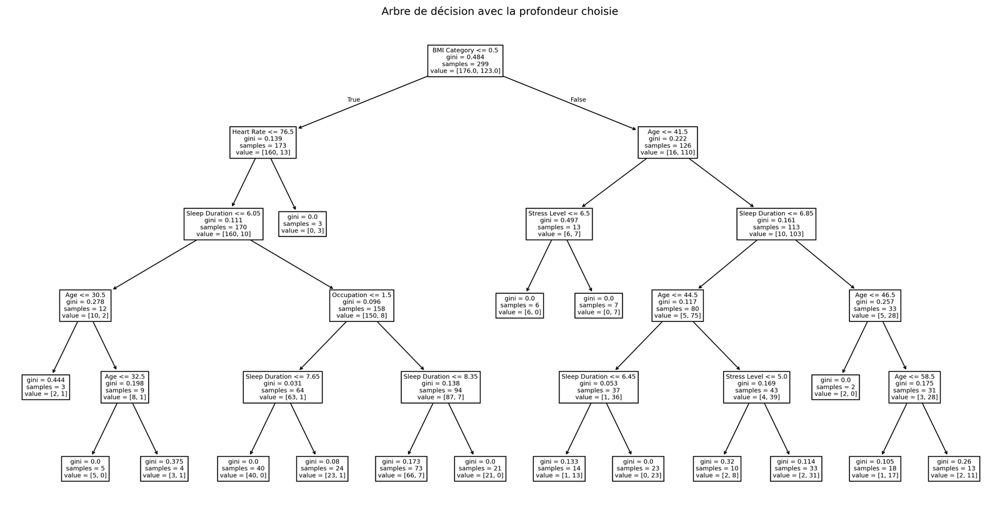

<em>Arbre de décision final (profondeur maximale = 5) : 93,3 % d'accuracy sur la base de test</em>

</div>

---

## 📖 Description

Ce projet analyse les **facteurs de vie qui influencent la santé du sommeil** (âge, stress, IMC, rythme cardiaque, durée de sommeil, activité physique, etc.) et construit un **arbre de décision** capable de prédire la présence d'un trouble du sommeil (**insomnie** ou **apnée du sommeil**).

Le script suit une démarche de data science de bout en bout :
**exploration → visualisation → tests statistiques → modélisation → optimisation → évaluation.**

> **Pourquoi ce sujet ?** Les troubles du sommeil sont une problématique de santé concrète qui concerne tout le monde, et le jeu de données associe variables physiologiques et habitudes de vie.

---

## ✨ Fonctionnalités

- 🔍 **Exploration** : `info()`, `describe()`, valeurs uniques et valeurs manquantes
- 📊 **Visualisations automatiques** : histogrammes, regroupements par tranches (`pd.cut`), boxplots bivariés, heatmap de corrélation
- 💾 **Sauvegarde automatique** des graphiques (300 dpi) dans `Graphiques/`, numérotés et nommés d'après leur titre
- 🩺 **Feature engineering** : transformation de la pression artérielle brute (`"120/80"`) en catégories médicales (hypotension / normale / hypertension, avec 3 niveaux de sévérité)
- 🧪 **Tests statistiques** : test de **Kruskal-Wallis** sur chaque variable numérique
- 🌳 **Modélisation** : `DecisionTreeClassifier`
- 🎯 **Optimisation** : choix de la profondeur maximale par **validation croisée à 10 plis**
- 📈 **Évaluation** : accuracy, matrice de confusion, classification report, courbe ROC et AUC (train vs test)

---

## 🔬 Étapes de l'analyse

| # | Étape | Détail |
|---|-------|--------|
| 1 | **Exploration** | Structure du DataFrame, statistiques descriptives, contrôle des valeurs manquantes |
| 2 | **Visualisation univariée** | Sexe, âge, profession, durée et qualité du sommeil, activité physique, stress, IMC, pression artérielle, rythme cardiaque |
| 3 | **Analyse bivariée** | Boxplots « sain vs trouble du sommeil » avec médianes annotées, heatmap de corrélation de Pearson |
| 4 | **Tests statistiques** | Kruskal-Wallis (H₀ : pas de différence entre les deux groupes), seuil α = 0,05 |
| 5 | **Modélisation** | Encodage des variables catégorielles, split 80/20, arbre non élagué |
| 6 | **Optimisation** | Recherche de `max_depth` (1 à 14) par validation croisée, arbre élagué final |
| 7 | **Évaluation** | Métriques train/test, importance des variables, courbes ROC |

> 🎯 **Variable cible** : `Outcome` est **binaire**. Elle vaut `0` pour *No Sleep Disorder* et `1` pour *Insomnia* **ou** *Sleep Apnea* (les deux troubles sont regroupés).

---

## 🗂️ Structure du projet

```text
Sleep-Healt-and-Lifestyle-Dataset/
├── 📄 Arbre_décisionnel_Sleep_healt.py   # Script complet : analyse + machine learning
├── 📄 Sleep_healt.csv                    # Dataset (374 patients, 13 colonnes)
├── 📄 README.md                          # Ce fichier
├── 📁 images/                            # Visuels utilisés dans ce README
└── 📁 Graphiques/                        # (généré à l'exécution) graphiques en PNG
```

### 📋 Dataset

Source : *Sleep Health and Lifestyle Dataset* ([Kaggle](https://www.kaggle.com/)) · **374 lignes, aucune valeur manquante**.

| Colonne | Description |
|---------|-------------|
| `Person ID` | Identifiant (exclu du modèle) |
| `Gender` | Sexe |
| `Age` | Âge (27 à 59 ans) |
| `Occupation` | Profession |
| `Sleep Duration` | Durée de sommeil (heures) |
| `Quality of Sleep` | Qualité du sommeil (échelle 1-10) |
| `Physical Activity Level` | Niveau d'activité physique (minutes/jour) |
| `Stress Level` | Niveau de stress (échelle 1-10) |
| `BMI Category` | Catégorie d'IMC |
| `Blood Pressure` | Pression artérielle (`systolique/diastolique`) |
| `Heart Rate` | Fréquence cardiaque au repos (bpm) |
| `Daily Steps` | Nombre de pas par jour |
| `Sleep Disorder` | Trouble du sommeil : `None`, `Insomnia`, `Sleep Apnea` |

---

## ⚙️ Prérequis et installation

- **Python 3.12 ou supérieur** (le script utilise une syntaxe de f-string imbriquée non supportée avant 3.12)
- `pip`

```bash
# 1. Cloner le dépôt
git clone https://github.com/julesfrichetpro-tech/Sleep-Healt-and-Lifestyle-Dataset.git
cd Sleep-Healt-and-Lifestyle-Dataset

# 2. (Recommandé) Créer un environnement virtuel
python -m venv venv
source venv/bin/activate        # Windows : venv\Scripts\activate

# 3. Installer les dépendances
pip install pandas numpy scikit-learn seaborn matplotlib scipy
```

### 📦 Bibliothèques utilisées

| Bibliothèque | Rôle |
|--------------|------|
| `pandas` | Manipulation des données |
| `numpy` | Calcul numérique |
| `scikit-learn` | Arbre de décision, split train/test, validation croisée, métriques ROC/AUC |
| `seaborn` | Boxplots et heatmap |
| `matplotlib` | Visualisations et sauvegarde des figures |
| `scipy` | Test de Kruskal-Wallis |

---

## 🚀 Utilisation

Lance le script **depuis le dossier contenant `Sleep_healt.csv`** (le fichier est chargé via un chemin relatif) :

```bash
python Arbre_décisionnel_Sleep_healt.py
```

Le script :
1. affiche les statistiques descriptives dans la console ;
2. ouvre chaque graphique à l'écran (`plt.show()`) : **ferme la fenêtre pour passer au suivant** ;
3. sauvegarde chaque graphique dans `Graphiques/` ;
4. affiche les performances du modèle et un résumé final.

💡 **Exécution sans interface graphique** (serveur, CI, ou pour éviter les fenêtres) :

```bash
# Linux / macOS
MPLBACKEND=Agg python Arbre_décisionnel_Sleep_healt.py

# Windows (PowerShell)
$env:MPLBACKEND="Agg"; python Arbre_décisionnel_Sleep_healt.py
```

---

## 🖼️ Exploration des données

Un premier regard sur l'échantillon : population de 27 à 59 ans, durées de sommeil entre 5h30 et 8h30 pour la grande majorité, et plus d'un patient sur trois concerné par un trouble du sommeil.

<table>
  <tr>
    <td align="center">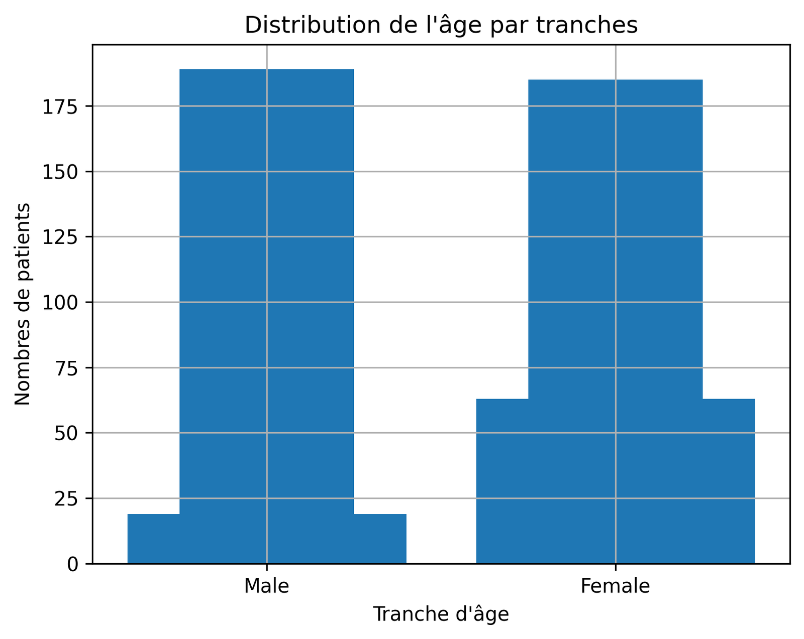<br><sub><b>Âge par tranches</b></sub></td>
    <td align="center"><br><sub><b>Durée de sommeil par tranches</b></sub></td>
  </tr>
  <tr>
    <td align="center">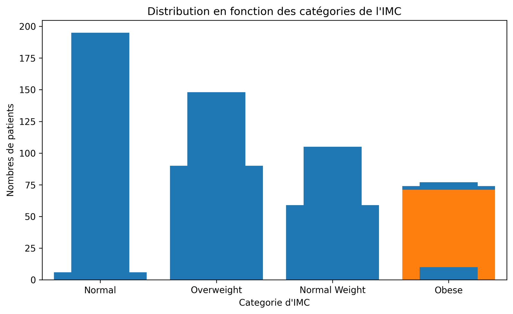<br><sub><b>Catégories d'IMC</b></sub></td>
    <td align="center">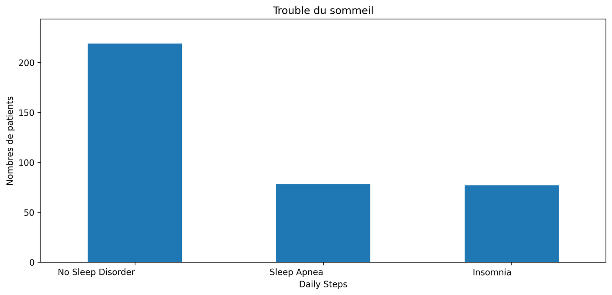<br><sub><b>Troubles du sommeil</b></sub></td>
  </tr>
  <tr>
    <td align="center" colspan="2">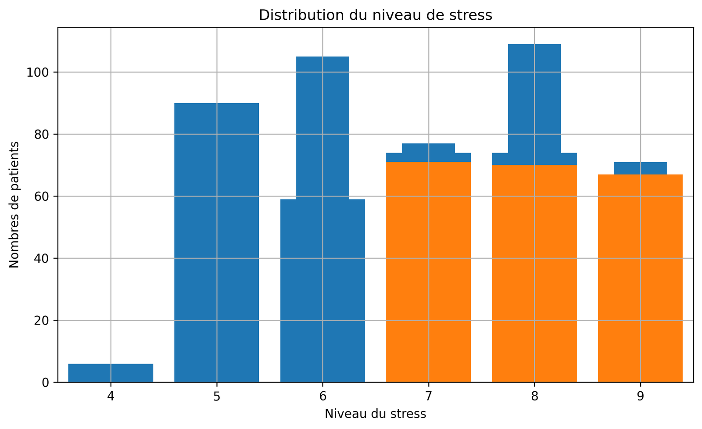<br><sub><b>Niveau de stress</b></sub></td>
  </tr>
</table>

---

## 📊 Résultats

### 📦 Analyse bivariée : sain vs trouble du sommeil

Les boxplots comparent chaque variable entre les patients **sans trouble (0)** et **avec trouble (1)**. Les médianes sont annotées sur chaque graphique.

<table>
  <tr>
    <td align="center">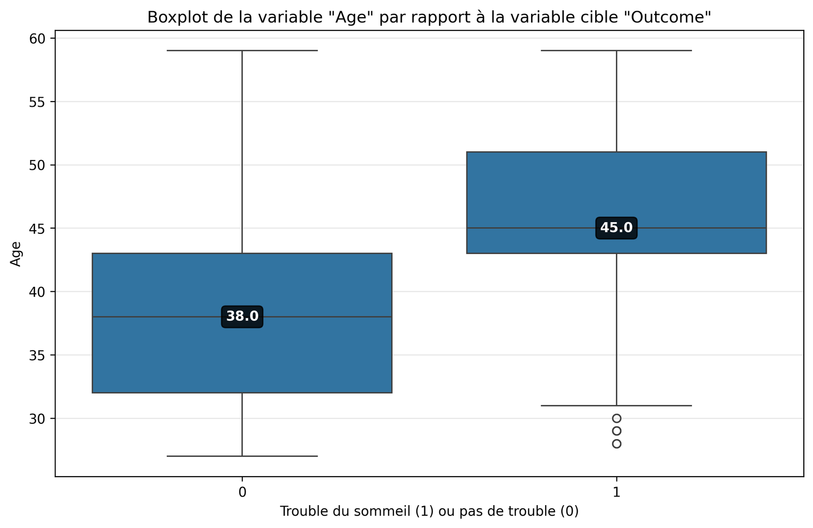<br><sub><b>Âge</b> · 38 → 45 ans</sub></td>
    <td align="center">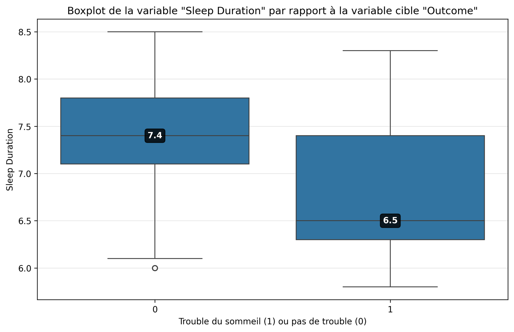<br><sub><b>Durée de sommeil</b> · 7,4 → 6,5 h</sub></td>
  </tr>
  <tr>
    <td align="center">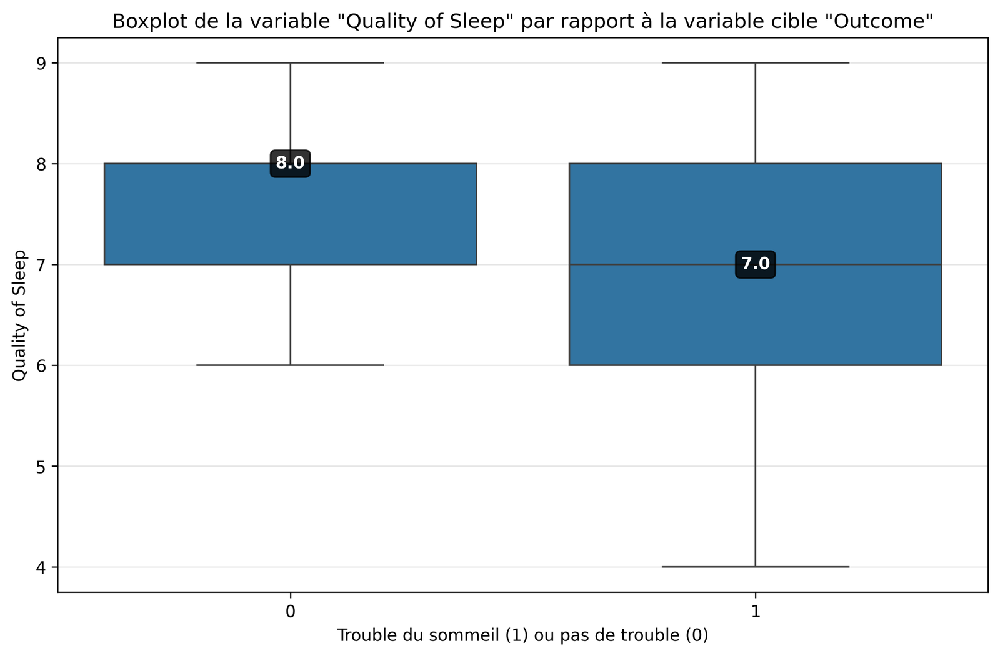<br><sub><b>Qualité du sommeil</b> · 8 → 7</sub></td>
    <td align="center">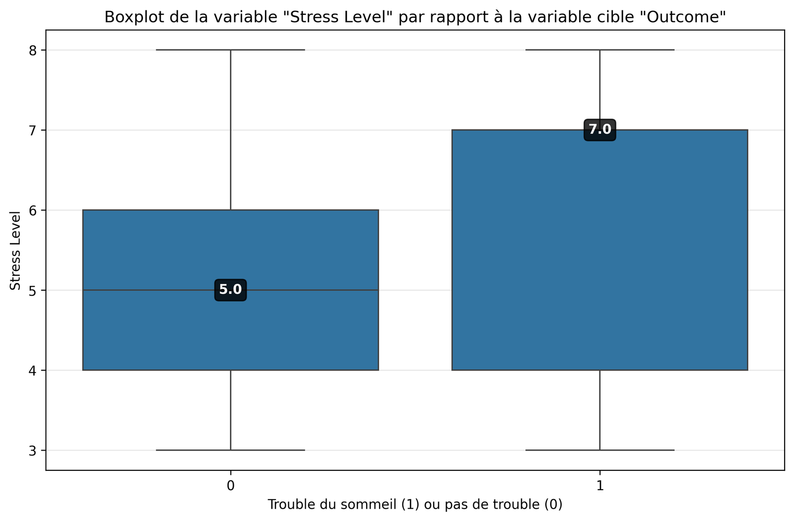<br><sub><b>Niveau de stress</b> · 5 → 7</sub></td>
  </tr>
  <tr>
    <td align="center">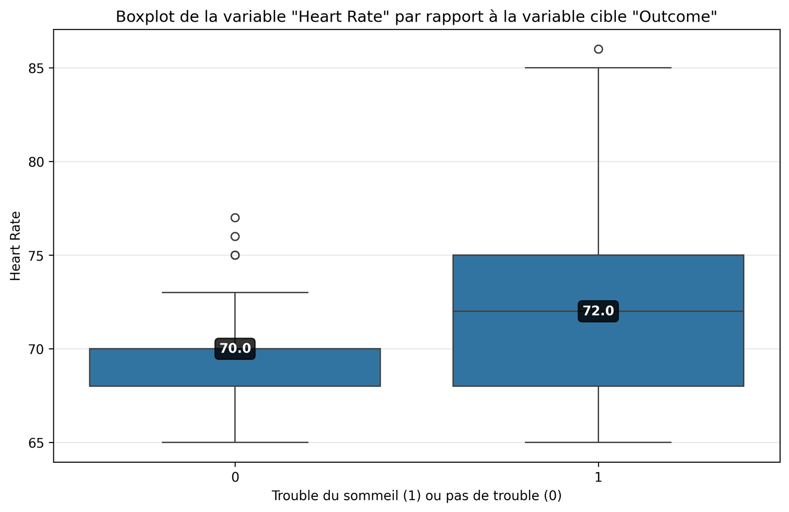<br><sub><b>Rythme cardiaque</b> · 70 → 72 bpm</sub></td>
    <td align="center">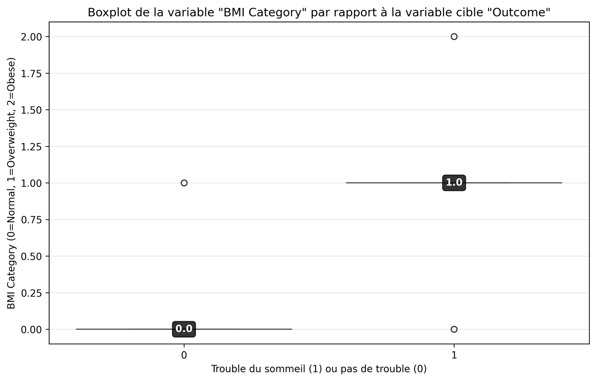<br><sub><b>Catégorie d'IMC</b> · 0 = normal, 1 = surpoids, 2 = obèse</sub></td>
  </tr>
</table>

Les patients avec trouble sont en moyenne **plus âgés, plus stressés, dorment moins et moins bien**.

### 🧪 Tests statistiques (Kruskal-Wallis)

| Variable | p-value | Significative (α = 0,05) |
|----------|---------|:------------------------:|
| Age | 2,99 × 10⁻¹⁸ | ✅ |
| Sleep Duration | 3,63 × 10⁻⁹ | ✅ |
| Quality of Sleep | 5,73 × 10⁻⁹ | ✅ |
| Heart Rate | 7,89 × 10⁻⁸ | ✅ |
| Stress Level | 2,46 × 10⁻³ | ✅ |
| Physical Activity Level | 1,69 × 10⁻¹ | ❌ |
| Daily Steps | 1,54 × 10⁻¹ | ❌ |

### 🔥 Matrice de corrélation

<div align="center">
  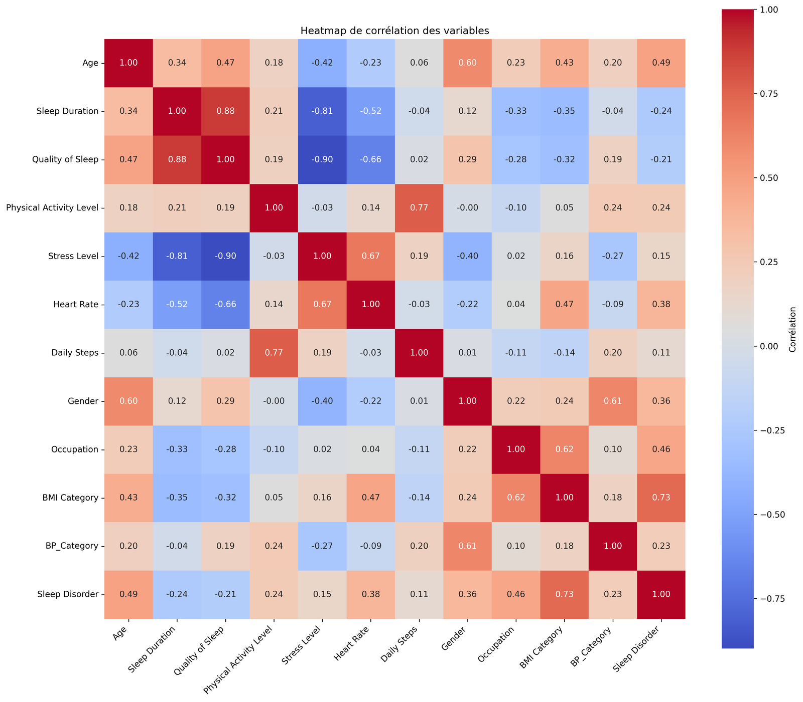
  <p><em>Corrélation de Pearson entre toutes les variables (catégorielles encodées)</em></p>
</div>

À retenir :
- 🔗 la **catégorie d'IMC** est la variable la plus corrélée au trouble du sommeil (**r = 0,73**) ;
- 😰 le **stress** est très fortement corrélé à la qualité du sommeil (r = −0,90) et à sa durée (r = −0,81) ;
- 🚶 le nombre de **pas quotidiens** est lié au niveau d'activité physique (r = 0,77).

---

## 🌳 Modélisation

### 🎯 Optimisation de la profondeur par validation croisée

Pour limiter le surapprentissage, la profondeur maximale de l'arbre est choisie par validation croisée à 10 plis sur la base d'entraînement. La **profondeur optimale retenue est 5**.

<div align="center">
  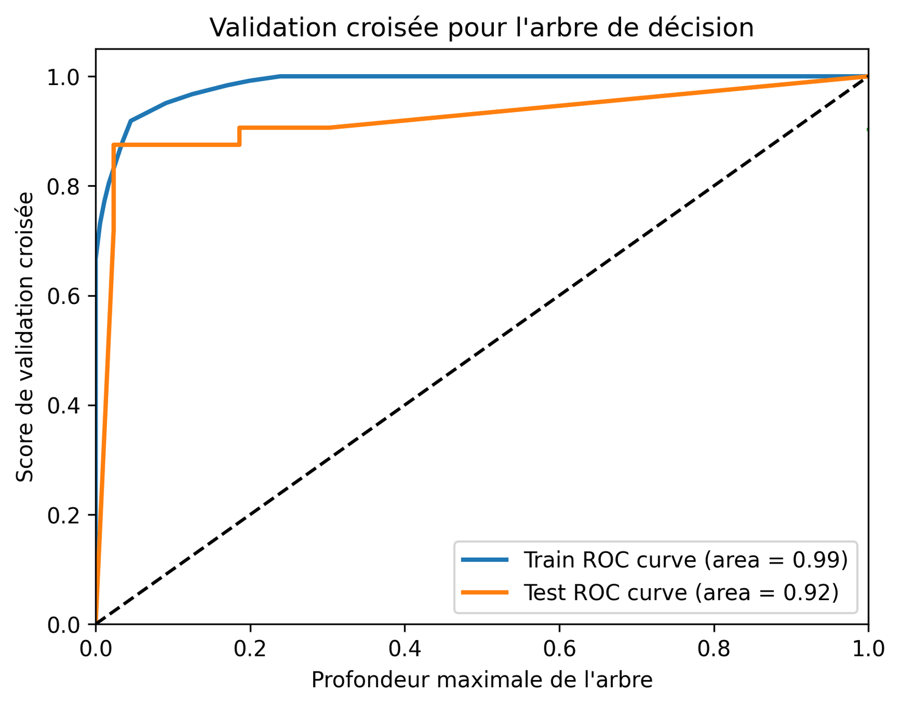
</div>

### 🏆 Importance des variables

<div align="center">
  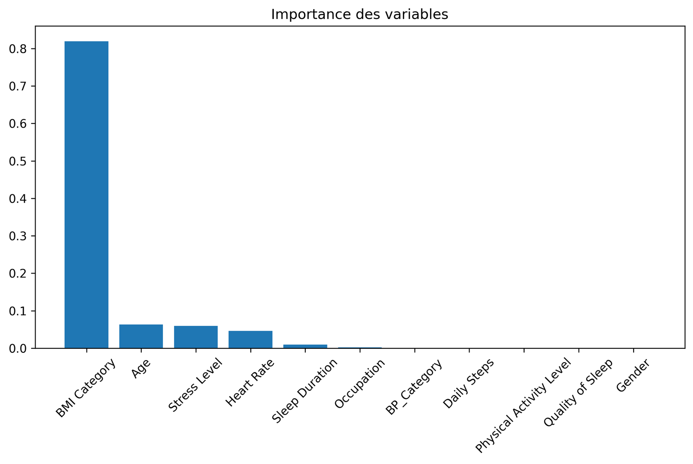
  <p><em>L'IMC domine largement (≈ 0,8), suivi de l'âge, du stress et du rythme cardiaque</em></p>
</div>

### 📈 Performances du modèle final

| Métrique | Train | Test |
|----------|:-----:|:----:|
| **Accuracy** | 93,98 % | **93,33 %** |
| **AUC ROC** | 0,97 | **0,90** |

<div align="center">
  
  <p><em>Courbes ROC du modèle élagué (train : AUC = 0,97 · test : AUC = 0,90)</em></p>
</div>

**Matrice de confusion (test, 75 patients)**

|  | Prédit : sain | Prédit : trouble |
|--|:-------------:|:----------------:|
| **Réel : sain** | 42 | 1 |
| **Réel : trouble** | 4 | 28 |

**Classification report (test)**

| Classe | Précision | Rappel | F1-score | Support |
|--------|:---------:|:------:|:--------:|:-------:|
| 0 · Sans trouble | 0,91 | 0,98 | 0,94 | 43 |
| 1 · Trouble | 0,97 | 0,88 | 0,92 | 32 |

Le modèle détecte presque tous les patients sans trouble (rappel 0,98) et ses prédictions « trouble » sont fiables (précision 0,97), mais il **manque 4 patients malades sur 32** (rappel 0,88).

---

## ⚠️ Limites

- 📉 **Petit jeu de données** (374 lignes, split 80/20 → 75 patients en test) : les métriques sont sensibles au découpage.
- 🔁 **Profils répétés** : une grande partie des lignes sont identiques d'un patient à l'autre (hors `Person ID`). Des profils identiques peuvent se retrouver à la fois en train et en test, ce qui **surestime probablement les performances**.
- 🧬 **Données de démonstration** : le dataset est un jeu de données public Kaggle, à utiliser dans un cadre pédagogique.
- 🎯 **Cible binaire** : insomnie et apnée sont regroupées, le modèle ne les distingue pas.
- 🩺 Ce projet **n'est pas un outil de diagnostic médical**.

---

## 🔭 Pistes d'amélioration

- Dédoublonner les données avant le split, et utiliser une validation croisée stratifiée
- Prédire les **3 classes** (sain / insomnie / apnée)
- Comparer avec d'autres modèles (Random Forest, Gradient Boosting, régression logistique)
- Optimiser plusieurs hyperparamètres avec `GridSearchCV` (`criterion`, `max_depth`, `min_samples_leaf`…)
- Découper le script en modules (`data.py`, `plots.py`, `model.py`) et ajouter un `requirements.txt`

---

## 👤 Auteur

**Jules Frichet** · [@julesfrichetpro-tech](https://github.com/julesfrichetpro-tech)

---

<div align="center">

⭐ Si ce projet t'a été utile, n'hésite pas à lui laisser une étoile !

</div>
